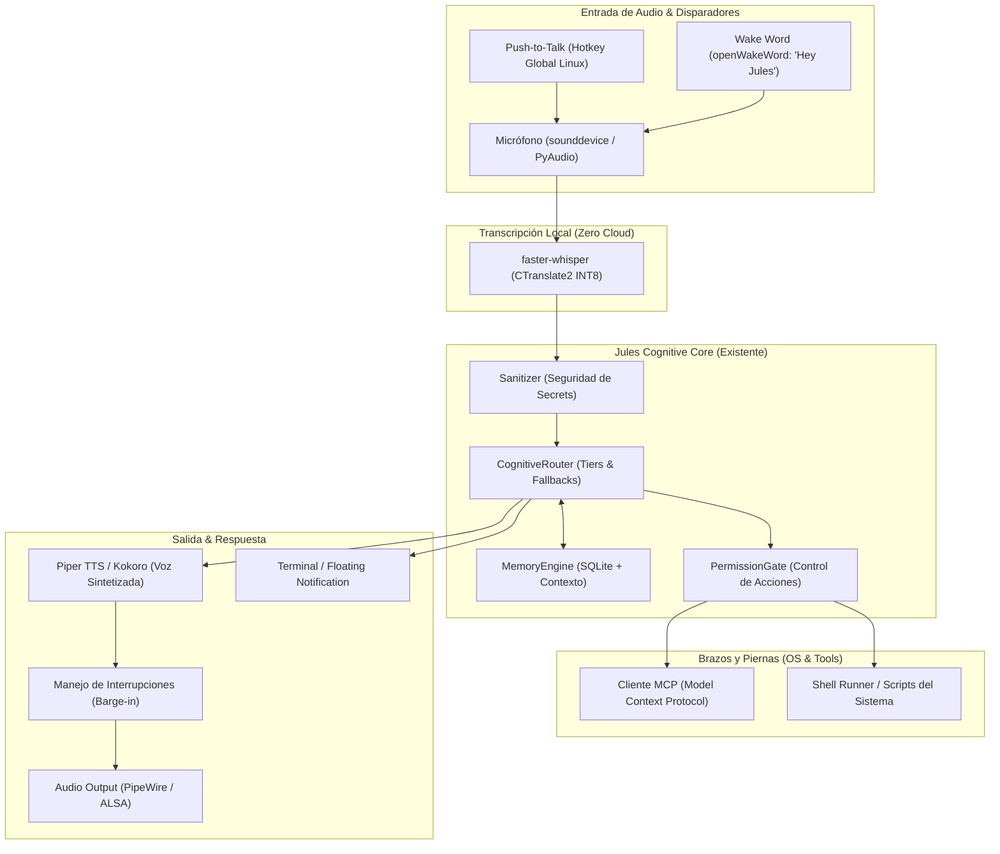

# Plan de Evolución: Jules hacia Arquitectura Jarvis (Local-First Voice & OS Assistant)

> **Estado:** Propuesta Técnica y Hoja de Ruta  
> **Autor:** Esteban David Marrugo Jassir & Mentor  
> **Objetivo:** Transformar a Jules en un asistente de terminal y voz persistente para Linux al estilo Jarvis, pausando la TUI en Rust y adaptando la arquitectura modular de OpenJarvis sin dependencias pesadas innecesarias.

---

## 1. Diagnóstico y Reposicionamiento

### 1.1 El Problema Superado (La trampa del clon de OpenCode)
Durante las últimas fases, el desarrollo de Jules se desvió hacia la replicación de una interfaz de terminal compleja en Rust ([`jules-tui`](file:///home/e12jassir/Proyectos/Jules/jules-tui)), consumiendo tiempo y esfuerzo en:
- Overlays, menús modales y cálculo de geometrías seguras en Ratatui.
- Semántica de teclado para slash commands (`/models`, `/sessions`, `/provider`).
- Protocolos de renderizado y sincronización visual.

Este enfoque alejó al proyecto de su propósito fundacional declarado en [`JULES.md`](file:///home/e12jassir/Proyectos/Jules/JULES.md): **ser una capa cognitiva viva, persistente y accionable sobre el sistema operativo Linux**.

### 1.2 Estado de `jules-tui`
- **Decisión:** Se congela y pausa de manera definitiva por ahora.
- **Estado técnico:** Queda intacto, compilando y con sus **23 pruebas unitarias e integración en verde** (15 en `main.rs` + 8 en `commands_test.rs`).
- **Futuro:** Permanecerá en el repositorio sin estorbar el camino crítico, disponible para retomarse cuando el núcleo de voz y sistema esté 100% operativo.

---

## 2. Nueva Arquitectura: Jules Voice & OS Core

Adaptamos los principios de alto rendimiento de **OpenJarvis** (`1nsaneeee/OpenJarvis`), pero optimizados para la filosofía UNIX de Linux (sin obligar a correr Docker ni Redis para un asistente monousuario):

### 2.1 Principios de Diseño
1. **Local-First & Privado:** El audio del micrófono jamás viaja a la nube. La transcripción (STT) y la síntesis (TTS) corren en local en la CPU/GPU del equipo.
2. **Latencia Crítica (< 1.5s):** Desde que el usuario deja de hablar hasta que Jules comienza a reproducir sonido o responder, el retardo total debe ser mínimo.
3. **Daemon Ligero (UNIX Way):** Un servicio de fondo en Python usando `asyncio` nativo y un UNIX Domain Socket (`/run/user/$UID/jules.sock`), prescindiendo totalmente de Docker o Redis.
4. **Barge-in (Interrupción Natural):** Si Jules está hablando y el usuario empieza a hablar o presiona el hotkey, la síntesis de audio se corta de inmediato.

---

## 3. Desglose de Módulos a Construir

### Módulo V1: `jules/voice/` (Motor de Audio)
- [`listener.py`](file:///home/e12jassir/Proyectos/Jules/jules/voice/listener.py):
  - Captura continua con detección de silencio (VAD - Voice Activity Detection vía `webrtcvad` o `silero-vad`).
  - Soporte para **Push-to-Talk**: disparo inmediato vía señal/socket.
  - Soporte opcional de **Wake-word**: modelo ligero con `openWakeWord`.
- [`transcriber.py`](file:///home/e12jassir/Proyectos/Jules/jules/voice/transcriber.py):
  - Motor de inferencia local con `faster-whisper` (`whisper-base` o `whisper-small` cuantizado a `int8`).
  - Detección de idioma automática o forzada a español/inglés.
- [`speaker.py`](file:///home/e12jassir/Proyectos/Jules/jules/voice/speaker.py):
  - Síntesis local rápida con `piper-tts` (modelos ONNX de baja latencia con voces en español e inglés) o `kokoro-onnx`.
  - Canal de cancelación (`stop()`) para silenciar al instante si hay interrupción.

### Módulo V2: `jules/daemon/` (Servicio de Fondo & IPC)
- [`service.py`](file:///home/e12jassir/Proyectos/Jules/jules/daemon/service.py):
  - Bucle principal asíncrono que mantiene el `CognitiveRouter`, la memoria SQLite y los modelos cargados en RAM listos para responder.
  - Generación de unidad `systemd --user` para arranque automático.
- [`ipc.py`](file:///home/e12jassir/Proyectos/Jules/jules/daemon/ipc.py):
  - Servidor y cliente de UNIX Domain Socket. Permite que un comando CLI ultra rápido como `jules "revisa el disco"` o un script de atajo en Hyprland/i3 hable con el daemon ya caliente sin pagar el costo de inicio de Python.

### Módulo V3: `jules/mcp/` (Acciones en el Sistema)
- [`client.py`](file:///home/e12jassir/Proyectos/Jules/jules/mcp/client.py):
  - Conexión estándar a servidores MCP locales (ejecución de comandos, interacción con navegador, calendarios, archivos).
  - Gobernado por el [`PermissionGate`](file:///home/e12jassir/Proyectos/Jules/jules/core/permissions.py) existente de Jules para evitar acciones destructivas accidentales.

---

## 4. Fases de Ejecución

### Fase 1: Entorno y Transcripción Local (STT)
- [ ] Validar compatibilidad de `faster-whisper` y dependencias de audio (`sounddevice`, `numpy`, `scipy`) en el entorno virtual de Python.
- [ ] Implementar `jules/voice/transcriber.py` con test de latencia en un archivo de audio local.
- [ ] Implementar `jules/voice/listener.py` con grabación desde micrófono y VAD (Voice Activity Detection).

### Fase 2: Síntesis de Voz Local (TTS) y Barge-In
- [ ] Integrar `piper-tts` o `kokoro` para síntesis offline.
- [ ] Implementar `jules/voice/speaker.py` con soporte para reproducción en streaming (hablar a medida que llegan los chunks de texto del LLM).
- [ ] Implementar mecanismo de interrupción (cancelación de audio activa).

### Fase 3: Integración con el Cerebro de Jules
- [ ] Enlazar el pipeline de voz directamente con [`jules.core.chat_engine.ChatEngine`](file:///home/e12jassir/Proyectos/Jules/jules/core/chat_engine.py).
- [ ] Asegurar que las consultas por voz queden registradas en [`MemoryEngine`](file:///home/e12jassir/Proyectos/Jules/jules/memory/engine.py) y respeten la personalidad configurada en `jules/personality/`.
- [ ] Crear el comando interactivo `python -m jules voice` para pruebas completas de extremo a extremo.

### Fase 4: Daemon de Linux & Atajo Global (Push-to-Talk)
- [ ] Implementar el socket IPC en `jules/daemon/ipc.py`.
- [ ] Crear el script disparador de hotkey (`jules-listen`) para mapear a una tecla en el gestor de ventanas (ej. `Super + Space` o tecla de micrófono dedicada).
- [ ] Configurar el archivo de servicio `jules.service` para `systemd --user`.

### Fase 5: Expansión de Herramientas (MCP & OS Control)
- [ ] Incorporar el cliente MCP en el flujo de inferencia de Jules.
- [ ] Habilitar herramientas clave: control multimedia (playerctl), apertura de apps, monitoreo de recursos del sistema.

---

## 5. Criterios de Aceptación Técnicos
1. **Pruebas de Regresión:** Los 23 tests de `jules-tui` y los 225 tests unitarios válidos de Python deben mantenerse íntegros.
2. **Latencia STT:** `faster-whisper` debe transcribir un fragmento de audio de 3 segundos en menos de 350ms en CPU local.
3. **Cero Dependencias de Infraestructura:** No se requerirá Docker, ni Redis, ni contenedores adicionales para que Jules funcione en cualquier distribución Linux.
